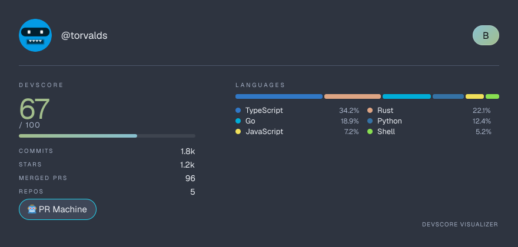
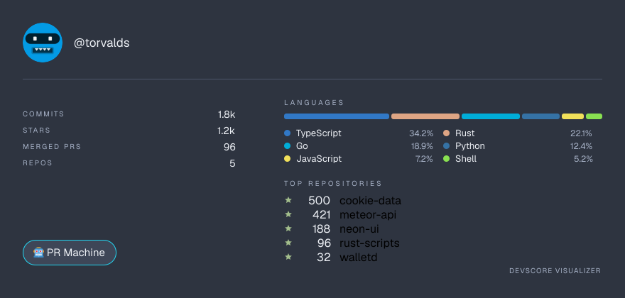
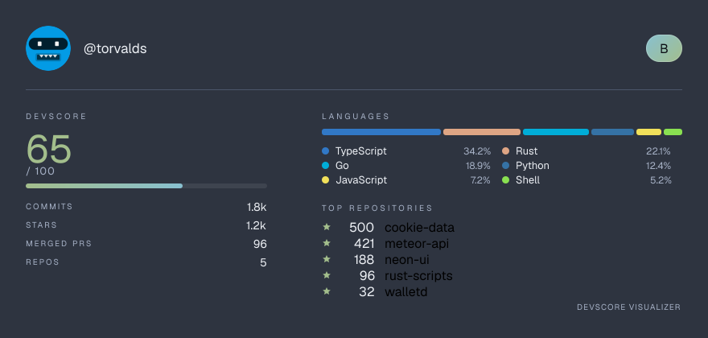
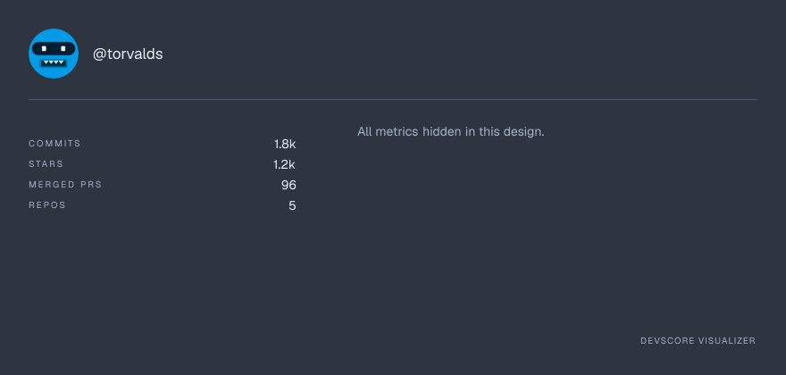
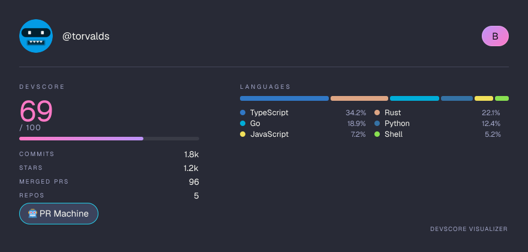

# DevScore Visualizer — GitHub Profile & Repo Analyzer

Analyze any GitHub username or repo: compute a **0–100 DevScore**, explore a live activity
dashboard, and generate **shareable README / social cards** (SVG + PNG) with themes and
per-section toggles.



## Features

- **DevScore 0–100** — weighted score across commit frequency, PR activity, star power and
  streaks, with an S+/S/A/B/C/D/E grade badge.
- **Activity dashboard** — stat cards, language donut, commit activity charts, commit clock
  and contribution streak summary for any profile at `/analyze/<username>`.
- **Shareable cards** — themed 880×420 SVG and PNG cards with a base64-inlined avatar
  (safe to embed in GitHub READMEs — no external image fetches inside the SVG).
- **Developer personas** — Night Owl, PR Machine, Repo Hoarder and more, derived from the data.
- **Graceful fallback** — when the GitHub API is rate-limited, cards render with labeled
  sample data instead of failing; unknown users return a clean 404 JSON.

## Quick start

```bash
npm install

# optional but recommended: live data instead of fallback samples
cp .env.example .env.local   # then paste a GitHub token into GITHUB_TOKEN

npm run dev                  # http://localhost:3000
```

## Environment variables

| Name                 | Required | What it does                                                                 |
|----------------------|----------|------------------------------------------------------------------------------|
| `GITHUB_TOKEN`       | no       | GitHub PAT used for live data. Without it you get 60 req/h (rate-limit fallback); with it, 5,000 req/h. Create one at <https://github.com/settings/tokens> (no scopes needed for public data). |
| `NEXT_PUBLIC_APP_URL`| no       | Public origin used for Open Graph metadata URLs in `app/layout.tsx`.          |

Copy `.env.example` to `.env.local` and fill in your own token — real tokens (`.env*`) are
git-ignored and never committed.

## Card API

Both endpoints render the same card and accept the same query parameters:

| Endpoint                  | Format | Notes                                   |
|---------------------------|--------|-----------------------------------------|
| `GET /api/analyze/<user>` | JSON   | Full analysis payload: user, repos, languages, contributions, totals, DevScore breakdown |
| `GET /api/card/<user>`    | SVG    | Inlined base64 avatar, CORS enabled      |
| `GET /api/og/<user>`      | PNG    | Satori/`next/og` render, emoji: twemoji  |

Query parameters:

| Param  | Values                                                                                       | Default                |
|--------|-----------------------------------------------------------------------------------------------|------------------------|
| `theme`| `github-dark`, `dracula`, `cyberpunk`, `nord`, `one-dark`                                      | `github-dark`          |
| `show` | Comma list of `score,langs,persona,repos`, or `none`. With `score` off the big number, progress bar **and** grade badge are hidden. | all sections on        |

Example — everything on, Nord theme:

```md

```

Example — hide the score and the persona badge:

```md

```

## Project structure

```
app/         Next.js App Router: home page, /analyze/[username], API routes
  api/       analyze, card (SVG) and og (PNG) endpoints
components/  React UI: dashboard, charts, card generator, search bar
lib/         GitHub data service, DevScore algorithm, SVG card renderer, themes
types/       Shared TypeScript types (GitHub payload, cards, personas)
artifacts/   Sample cards and toggle-state screenshots used by this README
```

## Screenshots

| State                                | Card |
|--------------------------------------|------|
| All sections on (Nord)               |       |
| DevScore toggled off (no number/bar/grade) |  |
| Persona badge toggled off            |  |
| Everything hidden (`show=none`)      |            |
| Dracula theme                        |  |

A raw SVG sample lives at [`artifacts/card-torvalds-nord.svg`](artifacts/card-torvalds-nord.svg).

## Tech notes

- Next.js 16 (App Router) · TypeScript · Tailwind CSS · framer-motion · Octokit & GitHub GraphQL
- SVG cards are hand-laid-out string templates with explicit geometry; PNG cards use `next/og`
  with satori-safe flex layouts (no flex shorthand, no bare fragments).
- Rate limiting / missing data never breaks a card: mock fallback analysis keeps renderers
  working end to end.
- Charts: Recharts · UI: Tailwind CSS, shadcn-style components, Lucide icons · Motion: framer-motion

## License

Distributed under the MIT License.
